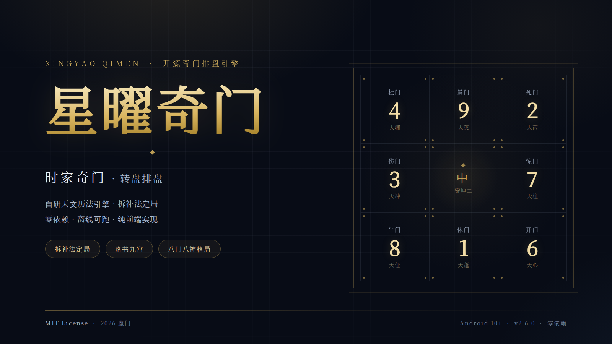
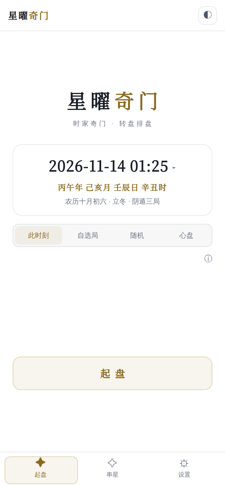
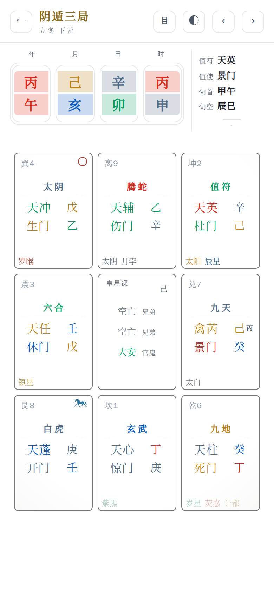
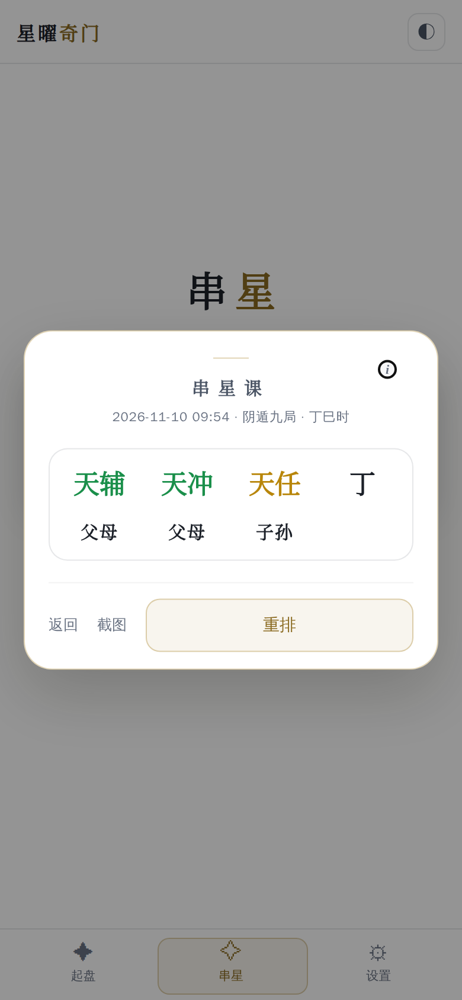
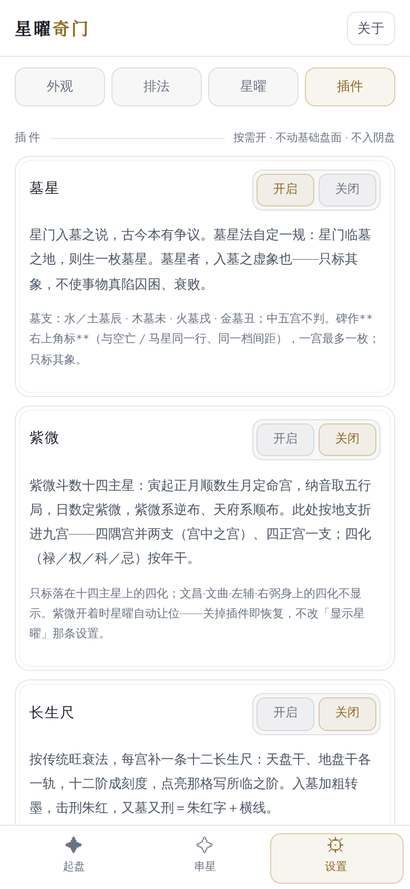
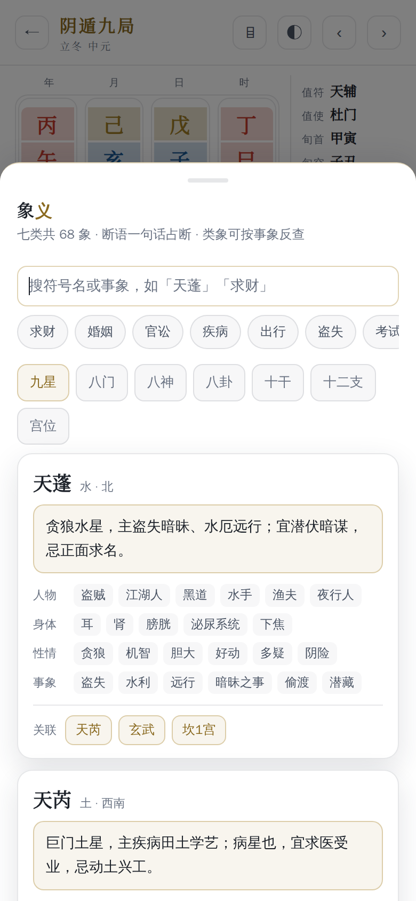
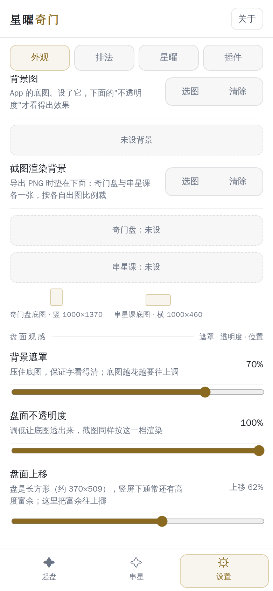

# 星曜奇门 XingYaoQiMen

> 纯前端实现的奇门遁甲排盘应用 —— 自研天文历法引擎，零依赖、离线可跑，Android 由极简 WebView 壳承载。



[](https://github.com/Yves11923331/XingYaoQiMen/actions/workflows/build.yml)
[](LICENSE)

-blue)

## 下载

最新版 **3.3.2（231）**，已签名、可直接覆盖安装：

| 文件 | 大小 | SHA-256 |
|---|---|---|
| [`dist/星曜奇门-3.3.2.apk`](dist/星曜奇门-3.3.2.apk) | 633 KB | `0261e546…`（见 `dist/README.md`） |

> 包名 `com.momen.xingyaoqimen`，minSdk 29（Android 10+）。
> 自行构建见文末「构建」；签名密钥不入库，按说明自备即可。

## 项目简介

星曜奇门是一套纯前端的奇门遁甲排盘工具。排盘引擎用浏览器原生 API 实现：

- 天文层手写 VSOP87 太阳视黄经、月亮黄经、节气交节时刻（不是正午采样）、朔望与 ΔT 修正；
- 历法层自实现干支纪日、四柱、农历（冬至在十一月 + 无中气置闰）；
- 排盘层三种定局：**拆补 / 置闰 / 阴盘（数字定局）**；九宫布盘、八门八神、空亡驿马、伏吟反吟；
- 判读层覆盖门迫门制、六仪击刑、三奇得使、干格、三遁等格局；
- 界面支持四套主题、串星课（六神 / 九星）、盘面同显、象义查询、真太阳时等进阶功能；
- 截图分享用 Canvas 2D 把盘面重画成 PNG，不依赖任何第三方库。

**零依赖**：无 jQuery / 无框架 / 无 CDN，断网也能完整运行。

<p align="center">
  
  
  
</p>

## 这也是它独有的

### 串星课：小六壬·加干（加星）

不是传统奇门课式。底本是《小六壬·加干》，工程把「加干」扩成「加星」：
**同一组四数，既可以读六神，也可以读九星** —— 换的只是三宫那三个符号，四数与六亲口径不变。

| 四数 | 取自 |
|---|---|
| 天宫数 | 农历月号（闰月照所闰之月号，不分支） |
| 地宫数 | 农历日号 |
| 人宫数 | 时辰序（子＝1 … 亥＝12） |
| 天干数 | 时干序（甲＝1 … 癸＝10） |

三档起课，四数来源不同、后面算的完全是同一套：

- **时间**（默认）：直接读**这一盘自己的 calendar** —— 盘面走过真太阳时 / 晚子时 / 阴盘，
  四数就跟着它走，绝不拿公历重算一遍；
- **数字**：手填四个 1–2 位数字。0 与两位越界值都放行、按域循环（前三位 0 当 6 / 9 论，
  即「逐宫退一位」；末位 0 当 10 论）；
- **随机**：Web Crypto 无偏抽样（前三位六神 1–6、九星 1–9；末位 1–10）。

**连根数起**：数到哪一宫，下一数就**从那宫重新起 1**（起始位算 1），不是每数都从大安起。
两套译法共用一条式子 `p = (p + n − 1) mod k`（k＝6 六神 / 9 九星），末位单独取天干。

| 译法 | 三宫符号 |
|---|---|
| 六神（默认） | 1 大安·木 → 2 留连·土 → 3 速喜·火 → 4 赤口·金 → 5 小吉·水 → 6 空亡·土 |
| 九星 | 1 天蓬·水 → 2 天芮·土 → 3 天冲·木 → 4 天辅·木 → 5 天禽·土 → 6 天心·金 → 7 天柱·金 → 8 天任·土 → 9 天英·火（到 9 回 1） |

九星**不按阳遁顺飞 / 阴遁逆飞，也不从盘面取值**：纯数字 → 星序，所以同一组四数在任何局、
任何时刻都得到同一张课；天禽独占第 5 格，不会出现九宫盘那种「禽芮」合写。

三宫对**主体（时干）**各给一个**六亲**：生干者父母、干生者子孙、克干者官鬼、干克者妻财、
同者兄弟 —— 六神用六神五行、九星用星五行，切译法时六亲跟着重算。
甲就是 1，没有奇门那套「甲不上盘」。

入口只有一处：起课页横栏第 4 格的「九星」勾选（课页 / 盘面同显 / 导出图 / 设置页都没有第二个）。
「读法」七节（顺序 · 起课 · 天干论 · 六亲 · 实例 · 六神类象 · 六亲类象）内联在课页里，
正文与底本逐字相同。

**盘面同显**：课直接画进**中宫**（角标「串星课」+ 三宫 + 时干），与九宫同框而**不动盘的
尺寸与位置**；屏幕与「截图」出的 PNG 走同一套比例，课只作注脚、不抢宫位字。时家（转 / 飞）
与阴盘显示；心盘与年 / 月 / 日家给不出四数，不显示。

### 插件：一个文件就是一个功能

往 `web/plugins/` 放一个 JS、调用一次 `Plugins.register({...})`，主程序就会自动在
「设置 → 插件」里生成开关，并把内容渲染进盘面与导出图，**不用改主代码**。
插件可以挂在宫位，也可以接管抬头四柱；`exclusive` 的插件会自动让其他插件让位。
**阴盘默认也适配**：插件默认在所有盘（含阴盘）渲染；只有排不进去的特殊插件才排除，
目前只有长生尺（标了 `blockInYin`）—— 这是硬规矩，不是开关。
契约见 [`web/plugins/README.md`](web/plugins/README.md)。

仓库自带六个：

| 插件 | 做什么 |
|---|---|
| 长生尺 | 每宫补一条十二长生尺：天盘干、地盘干各一轨，十二阶成刻度，点亮所临之阶；按标准盘几何排，阴盘不适配 |
| 浑仪 | 截图整张换成浑仪盘：八宫占八向、五层成五环，星曜按真实方位落在外环 |
| 日月年家 | 打开后起盘页出现「时家 / 日家 / 月家 / 年家」四层切换 |
| 墓星 | 星门临墓之地生一枚墓星：黑色墓碑角标，与空亡 / 马星同一行，一宫最多一枚；只标其象，不改事物本义 |
| 四柱 | 抬头四柱换一种排法：五行色、发丝框、柱间竖线 |
| 虚实法 | 四柱地支与宫位纳支对照：有支的宫（实）宫卡边框加深，没有的（虚）变浅；中五恒虚 |

<p align="center"></p>

### 象义：盘面符号的万物类象

七类共 **68 条**：九星 / 八门 / 八神 / 八卦 / 十干 / 十二支 / 宫位。
每条给断语、人物、身体、性情、事象，并互相关联——点「天蓬」能跳到「玄武」「坎 1 宫」。
五行与方位直接对齐引擎表（`STAR_WX` / `GATE_WX` / `PAL_WX` / `PAL_DIR`），
盘面与象义不会互相打架。按通行口径编写，不逐字摘录某部典籍，也不替它编典据。

<p align="center"></p>

### 透明背景与可选的导出底图

- 可设一张整屏底图：遮罩 0–90% 压住画面保证字清楚，盘面不透明度 5–100% 让底图透出来；
  顶栏、底栏、卡片在四套主题下都会换成半透，底图不会被「挖」出一块灰底。
- 导出图还能另选两张底图：**奇门盘一张（竖 1000×1784）、串星课一张（横 1000×460）**，
  导出时按各自比例铺满裁切，不透明度与屏幕同一档——看到什么就导出什么。
- 选图后进裁剪框，可拖动定位、滑块或双指缩放。

<p align="center"></p>

## 界面与交互

移动端优先的手感是这一版的重点，全部用原生 CSS/JS 实现，没有引入动画库：

- **四套主题**：素白 / 玄夜 / 墨玉 / 铜仪。辅助文字与金色强调色按小字号对比度校准，
  装饰线单独走令牌，不会为了“好看”牺牲可读性。
- **底栏滑块**：位置与尺寸取当前按钮的**实测盒子**（`offsetLeft/Top/Width/Height`），
  不再用“内容宽 ÷ 3 × 序号”估算，切换落点与文字/图标中心严格重合。
- **页面切换**：轻量交叉淡化 + 6px 上浮（260ms）。旧页用固定层托住淡出，
  没有空白帧；全程不用 `filter`、不做整屏位移，合成负担最低。
- **换柱提示**：切换时辰/日/月/年时，变化的那一柱做**分体翻牌**——
  上半先掀、下半后落（约 260ms），其余三柱与盘面纹丝不动。
  翻的是重建前克隆的旧牌面，不参与布局，盘面测量不受影响。
- **时间状态**：选过具体时刻后，那排分段的「此时刻」会自动变成「返回时」，
  点它即回到当前时刻；不在时间模式下自动复原。串星页的「时间」档同一套逻辑
  （选过大时刻后变成「返回时」，点它回到此刻）。
- **返回栈**：裁剪层、通用弹层、串星课课页、当前页逐层退，一次返回只退一层；
  通用弹层带对话框语义、焦点进入与恢复，关闭后移出读屏与键盘范围。
- **设置页**：四个分类分别记忆滚动位置，切分类、从底栏离开再回来都停在原处。
- **输入校验**：经纬度整串校验（`123abc`、超范围都会就地提示），
  保留用户输入、不静默截值、不误重排盘面。

另外还有：**阴盘**（数字定局 + 暗干；暗干坐在星曜那一行的槽位，与标准盘同一套行）、**心盘**（先点宫定符号再反推全盘）、
**真太阳时**（经度时差 + 均时差，标准时与换算结果同屏）。

## 快速开始（网页版）

任意静态服务器即可：

```bash
cd web
python3 -m http.server 8766 --bind 0.0.0.0
# 浏览器打开 http://127.0.0.1:8766/index.html
```

也可以直接把 `web/` 目录丢进任意静态托管（GitHub Pages、Netlify 等）。

## 构建 Android APK

### 本地构建

```bash
cd app
python3 build_xingyao.py
# 产物：app/out/星曜奇门-<版本>.apk
```

构建脚本内置七道质量门禁（CSS / 串星页面层 375 条 / 串星引擎 253 条 / 读法 / 开源声明 57 条 /
真太阳时 14 条 / 墓星 38 条），
任一失败即中止，不会产出坏包。

**签名密钥需要自备**：本仓库按安全原则不包含签名密钥。构建前请自建：

```
密钥/
├── xingyaoqimen.jks    # 你的签名密钥（别名 xingyao）
└── 密码.txt            # 密钥口令（明文一行）
```

> 覆盖安装已发布的正式版需要与官方包同一把钥匙；自用 / 测试场景可随意生成新密钥。

### 本地构建工具链

| 组件 | 位置 | 获取方式 |
|---|---|---|
| JDK 17 | 系统 PATH | `apt install openjdk-17-jre-headless` |
| aapt / zipalign | 系统 PATH | `apt install aapt zipalign` |
| apksigner | `/usr/share/java/apksigner.jar` | `apt install apksigner` |
| ecj.jar | `/root/dl/ecj.jar` | Maven Central `org.eclipse.jdt:ecj` |
| D8/R8 | `/root/at/r8.jar` | Google Maven `com.android.tools:r8` |
| android.jar (API 34) | `/root/at/android.jar` | Android SDK Platform 34 |

### 云端构建（GitHub Actions）

本仓库带 `.github/workflows/build.yml`：在 GitHub 网页「Actions → Build APK」手动触发，或推 `v*` 标签自动跑；
自动装配上述工具链、生成临时调试签名、执行同一套门禁并产出 APK artifact。

## 质量校验

```bash
# 七道构建门禁（python3 app/build_xingyao.py 第 0 步自动跑，任何一道红就中止）
NODE_PATH=/root/dsh-dom/node_modules node 校验/_check_css.js        # 类名/版本锚点
NODE_PATH=/root/dsh-dom/node_modules node 校验/_check_chuanxing.js  # 串星页面层：375 过
NODE_PATH=/root/dsh-dom/node_modules node 校验/_check_cx_engine.js  # 串星引擎：253 过
NODE_PATH=/root/dsh-dom/node_modules node 校验/_check_cxhelp.js     # 读法正文
NODE_PATH=/root/dsh-dom/node_modules node 校验/_check_license.js    # 开源声明 + 许可随包：57 过
NODE_PATH=/root/dsh-dom/node_modules node 校验/_check_truesolar.js  # 真太阳时：14 过
NODE_PATH=/root/dsh-dom/node_modules node 校验/_check_mu.js         # 墓星判定：38 过

# 无头浏览器真点一遍（加载 → 起盘 → 下一时辰 → 串星课弹层）
NODE_PATH=/usr/local/lib/node_modules/@deepseek-ai/dsh/node_modules \
  node 校验/_probe_runtime.js          # 测 web/ 源码
NODE_PATH=/usr/local/lib/node_modules/@deepseek-ai/dsh/node_modules \
  node 校验/_probe_runtime.js apk      # 测 app/out 最新包
```

脚本清单、当前基线与复核组见 [`校验/README.md`](校验/README.md)。

## 目录结构

```
.
├── web/            # 前端真源（唯一引擎）
│   ├── index.html
│   ├── css/        # 四套主题令牌 + 外壳/组件 + 九宫盘
│   ├── js/         # astro / lunar / qimen / patterns / store / snapshot / ui
│   │               # ＋ 串星课（cx / cxhelp / rng）与 marks（马星掩膜）
│   ├── fonts/      # 字体子集（OFL 1.1）
│   ├── licenses/   # 许可全文（随包）
│   └── plugins/    # 插件
├── app/            # Android WebView 壳（最小化）与构建脚本
│   ├── android/    # MainActivity + 清单 + 资源
│   └── build_xingyao.py
├── dist/           # 对外发布：安装包 + 版本 / SHA-256 台账
├── 小六壬·加干（2026.8.31）.txt   # 串星课底本（作者本人），门禁逐字对照基准
├── 校验/           # 七道门禁 + 复核脚本 + 无头浏览器探针（见其 README）
└── docs/           # 文档与配图（screenshots/ 为 README 截图）
```

## 技术架构

| 模块 | 职责 |
|---|---|
| `web/js/astro.js` | 儒略日、太阳视黄经（VSOP87）、月亮黄经、节气交节时刻、朔、ΔT |
| `web/js/lunar.js` | 干支纪日、四柱、农历（无中气置闰） |
| `web/js/qimen.js` | 定局（拆补 / 置闰）、地盘、天盘、八门、八神、空亡、驿马、伏吟反吟 |
| `web/js/yinpan.js` | 道家阴盘起局（数字定局、暗干；移植自 wrz1911/daojiayinpan） |
| `web/js/patterns.js` | 格局判读（门迫门制、三奇得使、三遁、伏吟反吟等） |
| `web/js/keying.js` | 十干克应 81 格（格名 / 断语；数据经 qimen-dunjia 整理） |
| `web/js/stars.js` | 星曜（日月五星四余：VSOP87 / Meeus 轨道根数 + 四余交点） |
| `web/js/store.js` | 本地存储（设置 + 盘面记录），带内存兜底 |
| `web/js/snapshot.js` | Canvas 2D 盘面截图（PNG；盘面同显的中宫课也在这里画） |
| `web/js/cx.js` / `cxhelp.js` | 串星课引擎（小六壬·加干，六神 / 九星双译法）与读法正文 |
| `web/js/rng.js` | 共享随机源（Web Crypto + 拒绝采样，唯一 `Math.random` 降级出口） |
| `web/js/ui.js` | 界面与交互 |

## 许可证

[MIT](LICENSE) © 2026 魔门 (Momen)。第三方内容与致谢见 [`NOTICE`](NOTICE)。

## 免责声明

本项目为传统文化研究工具，排盘结果仅供学习与参考，不构成任何决策建议。
